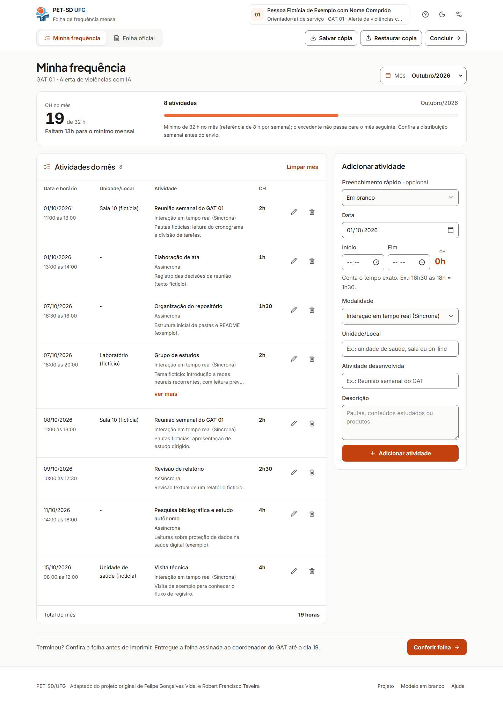

# PET-SD UFG: Folha de Frequência Mensal

Aplicação web para registrar as atividades do mês e gerar o **Registro de
Frequência e Atividades – PET-SD** do PET-Saúde: Informação e Saúde Digital
(PET-SD) da UFG, edição 2025–2027 (Edital Conjunto SEIDIGI/SGTES-MS nº 1/2025).

A folha gerada reproduz o modelo oficial do programa: faixa de logomarcas,
identificação com perfil marcado, oito colunas (Data, Unidade/Local, Atividade
Desenvolvida, Início, Fim, CH, Modalidade e Descrição), total de CH, nota de
prazo, assinaturas e página de instruções, em papel Carta na horizontal.

> Este repositório é um fork adaptado do projeto original feito para o
> PET-Saúde Clima. Veja [Créditos](#créditos).



Interface em branco e laranja, com o logo do PET-SD, seguindo a estrutura de
telas do app original. Antes, depois e a referência lado a lado:
[docs/validation/design-20261118](docs/validation/design-20261118/README.md).

## O que o app faz

- Cadastro local do participante (nome, perfil e GAT) e retomada sem arquivo no
  mesmo navegador.
- Lançamento de atividades com data, horários, Unidade/Local, modalidade,
  atividade desenvolvida e descrição; modelos rápidos para atividades recorrentes.
- Cálculo da carga horária (CH) exata e acompanhamento da meta de 32 h no mês.
- Prévia e impressão da folha oficial (Imprimir / salvar PDF) e modelo em branco
  em `.docx` e PDF.
- Comprovação fotográfica: fotos ou PDFs anexados saem nas páginas seguintes da folha.
- Cópia de segurança em `.json` para continuar em outro aparelho.

## Regras de carga horária (CH)

Fonte: Regimento Interno do PET-SD/UFG e o modelo oficial da ficha. Resumo em
[docs/regimento-pet.md](docs/regimento-pet.md).

- **CH = duração exata** entre início e fim, em minutos, sem arredondar:
  16:30–18:00 = `1h30`; 11:00–13:00 = `2h`; 18:00–19:00 = `1h`.
- Fim igual ou anterior ao início não é aceito (CH = 0).
- O total do mês soma minutos e aparece como `34 horas` ou `33h30`.
- Mínimo de **32 h no mês**; o excedente **não** passa para o mês seguinte.
- Atividades presenciais e in loco exigem registro fotográfico.
- O rodapé da folha reproduz o prazo do modelo (1º dia útil do mês seguinte). O
  prazo exibido no app é configurável (padrão: dia 19) e ainda precisa ser
  confirmado com a coordenação; ver [docs/adaptacao-pet-sd.md](docs/adaptacao-pet-sd.md).

## Como rodar

Requisitos: Node.js 22 (veja `.nvmrc`) e npm.

```bash
npm ci
npm run dev        # http://localhost:5000
```

| Script | O que faz |
|---|---|
| `npm run dev` | servidor de desenvolvimento na porta 5000 |
| `npm run build` / `npm start` | build de produção e servidor na porta 5000 |
| `npm run lint` | ESLint |
| `npm run typecheck` | `tsc --noEmit` |
| `npm run test:ui` | testes unitários (Node test runner, sem navegador) |
| `npm run test:e2e` | testes de navegador (Playwright, desktop e celular) |

Antes do primeiro `test:e2e`: `npx playwright install chromium`.

## Privacidade

- **Local-first.** Perfis, atividades e configurações ficam no `localStorage` do
  navegador; os comprovantes ficam no IndexedDB. Nada disso é enviado a um
  servidor. Quem usa o mesmo navegador pode abrir os perfis salvos nele.
- Não há sincronização entre aparelhos: use **Salvar cópia** (.json) e
  **Restaurar cópia**.
- A única rota de servidor (`/api/admin/session`) protege o painel local de
  configurações com uma frase de acesso; ela não recebe registros de frequência.
- O app usa o Vercel Analytics (sem cookies) para métricas agregadas de acesso.
- Este repositório é público: exemplos, testes e capturas usam apenas dados
  fictícios. Nunca versione dados reais de participantes ou de pacientes.

## Configuração do programa

Tudo o que identifica o programa (nome, edital, instituições, GATs, perfis,
modalidades, meta, prazo, links e textos da folha) fica em
[`src/config/program.ts`](src/config/program.ts). O motivo e o custo dessa
escolha estão em [docs/adr/0001-config-central-do-programa.md](docs/adr/0001-config-central-do-programa.md).

Pendências marcadas no código com `TODO(pet-sd)`: links de formulários (vazios =
botões ocultos) e prazo exibido. Logo e ícones são gerados do PNG oficial por
`scripts/brand/gerar-marca.py` (o original não entra no repositório).

## Deploy na Vercel

O app funciona sem variáveis de ambiente. O painel de configurações locais só
abre depois de configurar, no projeto da Vercel (Settings → Environment Variables):

- `ADMIN_PIN_HASH`: hash SHA-256, em hexadecimal, de uma frase longa de acesso.
- `ADMIN_SESSION_SECRET`: segredo aleatório com pelo menos 32 caracteres.

Para gerar os valores sem gravá-los no repositório:

```bash
printf %s 'UMA FRASE LONGA E EXCLUSIVA' | sha256sum   # valor de ADMIN_PIN_HASH
openssl rand -hex 32                                    # valor de ADMIN_SESSION_SECRET
```

Não use o prefixo `NEXT_PUBLIC_` (exporia o valor no navegador). Detalhes em
[docs/deployment-vercel.md](docs/deployment-vercel.md).

## Documentação

- [docs/architecture.md](docs/architecture.md): arquitetura, modelo de dados e armazenamento.
- [docs/regimento-pet.md](docs/regimento-pet.md): resumo do Regimento Interno do PET-SD/UFG.
- [docs/ui-ux.md](docs/ui-ux.md): telas, paleta, botões, logo, folha oficial e verificações de interface.
- [docs/design-pet-sd.md](docs/design-pet-sd.md): registro do novo design (decisões e antes × depois).
- [docs/deployment-vercel.md](docs/deployment-vercel.md): deploy e variáveis de ambiente.
- [docs/adaptacao-pet-sd.md](docs/adaptacao-pet-sd.md): registro da adaptação, decisões e pendências.
- [CONTRIBUTING.md](CONTRIBUTING.md): fluxo de Git, commits e verificações.

## Créditos

Este projeto é um fork de
[vvvvvdal/pet-folha-mensal](https://github.com/vvvvvdal/pet-folha-mensal),
criado para o PET-Saúde Clima UFG por
[Felipe Gonçalves Vidal](https://www.linkedin.com/in/vvvvvdal/) e
[Robert Francisco Taveira](https://www.linkedin.com/in/robert-taveira/).
A arquitetura local-first, a cópia de segurança, os comprovantes e a base da
interface vêm do trabalho deles, e a estrutura de telas segue a versão
publicada do app deles. Esta versão adapta regras, cadastro, folha, paleta e
marca ao PET-SD UFG.

## Licença

[MIT](LICENSE). O aviso de copyright original foi mantido.
