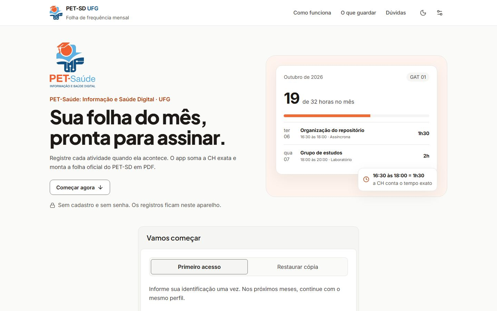
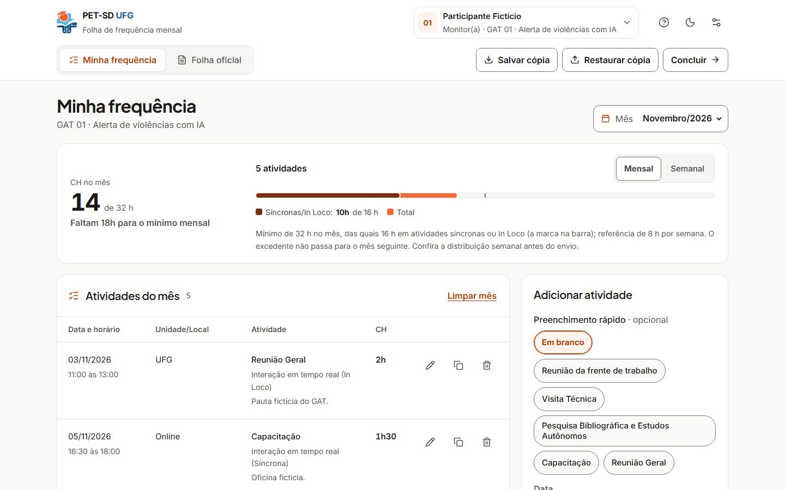

# PET-SD UFG: Folha de Frequência Mensal

**[Acessar o app](https://pet-sd-folha-mensal.vercel.app)** ·
[Avaliar o site](https://forms.gle/tjpuiFpgJ2Njnx7F7)

Aplicação web para registrar as atividades do mês e gerar o **Registro de
Frequência e Atividades – PET-SD** do PET-Saúde: Informação e Saúde Digital
(PET-SD) da UFG, edição 2025–2027 (Edital Conjunto SEIDIGI/SGTES-MS nº 1/2025).

A folha gerada reproduz o modelo oficial do programa: faixa de logomarcas,
identificação com perfil marcado, oito colunas (Data, Unidade/Local, Atividade
Desenvolvida, Início, Fim, CH, Modalidade e Descrição), total de CH, nota de
prazo, assinaturas e página de instruções, em papel Carta na horizontal.

> Este repositório é um fork adaptado do projeto original feito para o
> PET-Saúde Clima. Veja [Créditos](#créditos).



## O que o app faz



**Registro**
- Cadastro local do participante (nome, perfil e GAT), sem senha. Na entrada,
  cada perfil tem **Abrir**, **Editar** e **Excluir**; o menu com o nome no topo
  traz editar identificação, trocar participante, salvar cópia e sair.
- Atividade com data, início e fim, Unidade/Local, modalidade, atividade
  desenvolvida e descrição. A **data é livre**: cada GAT fecha a folha num dia
  (26 a 25, 20 a 19…), e a atividade fica na folha em que foi lançada
  ([ADR 0002](docs/adr/0002-datas-livres-na-folha.md)).
- **Preenchimento rápido pelo histórico**: as atividades já registradas viram
  opções que preenchem tudo menos a data. **Duplicar** copia uma atividade da
  lista para o formulário.

**Acompanhamento**
- CH exata e meta do mês em visão **Mensal** ou **Semanal**: 32 h no total, com
  o trecho de 16 h **Síncronas/In Loco** em laranja mais escuro.

**Folha oficial**
- Prévia fiel ao modelo do programa: faixa de logomarcas, identificação com o
  perfil marcado, oito colunas, total de CH, nota de prazo, assinaturas e página
  de instruções, em papel Carta na horizontal. Campo vazio sai como "-".
- **Imprimir** (também salva em PDF), **Baixar .docx** preenchido no modelo
  oficial, para editar ou completar à mão, e **Assinar no gov.br**. O modelo em
  branco está disponível em `.docx` e PDF.
- Comprovação fotográfica: fotos e PDFs anexados saem nas páginas seguintes.

**Salvar cópia × Concluir**
- **Salvar cópia** guarda o trabalho para continuar depois, em `.json`, o único
  formato que **Restaurar cópia** lê: a do mês (formato 1.3) e a do perfil
  inteiro (1.4, oferecida antes de excluir).
- **Concluir** fecha o mês: se faltar CH, avisa quanto falta sem impedir e
  depois oferece PDF, Word, gov.br e a cópia.

## Regras de carga horária (CH)

Fonte: Regimento Interno do PET-SD/UFG e o modelo oficial da ficha. Resumo em
[docs/regimento-pet.md](docs/regimento-pet.md).

- **CH = duração exata** entre início e fim, em minutos, sem arredondar:
  16:30–18:00 = `1h30`; 11:00–13:00 = `2h`; 18:00–19:00 = `1h`.
- Fim antes do início = a atividade **passou da meia-noite** e conta inteira no
  dia em que começou: 23:00–03:00 = `4h`. Vale até 12 h (um plantão das 19h às
  7h); acima disso, ou com fim igual ao início, o app pede para conferir.
- O total do mês soma minutos e aparece como `34 horas` ou `33h30`.
- Mínimo de **32 h no mês**, das quais **16 h em atividades Síncronas ou In
  Loco**; o excedente **não** passa para o mês seguinte. A barra do mês mostra o
  trecho síncrono em laranja mais escuro, com uma marca nas 16 h.
- Modalidades: **Interação em tempo real (In Loco)**, **Interação em tempo real
  (Síncrona)** e **Assíncrona**. O formulário começa em Síncrona.
- Atividades presenciais e in loco exigem registro fotográfico.
- Dados do programa (meta, modalidades que contam como síncronas, prazo) ficam
  em [`src/config/program.ts`](src/config/program.ts).
- Prazo: entregar a folha assinada ao coordenador do GAT **até o dia 19**
  (informado em 16/11/2026); é o prazo que o app exibe. A nota no rodapé da
  folha reproduz o texto do modelo oficial (1º dia útil do mês seguinte). Ver
  [docs/adaptacao-pet-sd.md](docs/adaptacao-pet-sd.md), decisão D6.

## Como rodar

Requisitos: Node.js 22 (veja `.nvmrc`) e npm.

```bash
npm ci
npm run dev        # http://localhost:5000
```

| Script | O que faz |
|---|---|
| `npm run dev` | servidor de desenvolvimento na porta 5000 |
| `npm run build` / `npm start` | build de produção e servidor na porta 5000 |
| `npm run lint` | ESLint |
| `npm run typecheck` | `tsc --noEmit` |
| `npm run test:ui` | testes unitários (Node test runner, sem navegador) |
| `npm run test:contrast` | contraste WCAG AA dos pares de cor dos temas claro e escuro |
| `npm run test:e2e` | testes de navegador (Playwright, desktop e celular) |

Antes do primeiro `test:e2e`: `npx playwright install chromium`.

## Privacidade

- **Local-first.** Perfis, atividades e configurações ficam no `localStorage` do
  navegador; os comprovantes ficam no IndexedDB. Nada disso é enviado a um
  servidor. Quem usa o mesmo navegador pode abrir os perfis salvos nele.
- Não há sincronização entre aparelhos: use **Salvar cópia** (.json) e
  **Restaurar cópia**.
- A única rota de servidor (`/api/admin/session`) protege o painel local de
  configurações com uma frase de acesso; ela não recebe registros de frequência.
- O app usa o Vercel Analytics (sem cookies) para métricas agregadas de acesso;
  ele só é carregado no build da Vercel.
- Este repositório é público: exemplos, testes e capturas usam apenas dados
  fictícios. Nunca versione dados reais de participantes ou de pacientes.

## Configuração do programa

Tudo o que identifica o programa (nome, edital, instituições, GATs, perfis,
modalidades, meta, prazo, links e textos da folha) fica em
[`src/config/program.ts`](src/config/program.ts). O motivo e o custo dessa
escolha estão em [docs/adr/0001-config-central-do-programa.md](docs/adr/0001-config-central-do-programa.md).

Links: `feedbackForm` aponta para o formulário de avaliação do PET-SD (botão
“Avaliar o site” no rodapé); `activityForm` fica vazio de propósito, porque o
programa não tem formulário de registro de atividades (link vazio = botão
oculto). Logo e ícones são gerados do PNG oficial por
`scripts/brand/gerar-marca.py` (o original não entra no repositório). Os PNGs
saem em paleta de 256 cores, sem diferença visível; a faixa de logos da ficha,
que vem do modelo oficial, é recomprimida por `scripts/brand/otimizar_png.py`.

## Deploy na Vercel

O app funciona sem variáveis de ambiente. O painel de configurações locais só
abre depois de configurar, no projeto da Vercel (Settings → Environment Variables):

- `ADMIN_PIN_HASH`: hash SHA-256, em hexadecimal, de uma frase longa de acesso.
- `ADMIN_SESSION_SECRET`: segredo aleatório com pelo menos 32 caracteres.

Para gerar os valores sem gravá-los no repositório:

```bash
printf %s 'UMA FRASE LONGA E EXCLUSIVA' | sha256sum   # valor de ADMIN_PIN_HASH
openssl rand -hex 32                                    # valor de ADMIN_SESSION_SECRET
```

Não use o prefixo `NEXT_PUBLIC_` (exporia o valor no navegador). Detalhes em
[docs/deployment-vercel.md](docs/deployment-vercel.md).

## Documentação

- [docs/architecture.md](docs/architecture.md): arquitetura, modelo de dados e armazenamento.
- [docs/adr/](docs/adr/): decisões de arquitetura ([0001](docs/adr/0001-config-central-do-programa.md)
  config central do programa; [0002](docs/adr/0002-datas-livres-na-folha.md) datas livres na folha).
- [docs/regimento-pet.md](docs/regimento-pet.md): resumo do Regimento Interno do PET-SD/UFG.
- [docs/adaptacao-pet-sd.md](docs/adaptacao-pet-sd.md): registro da adaptação, decisões e pendências.
- [docs/ui-ux.md](docs/ui-ux.md) e [docs/design-pet-sd.md](docs/design-pet-sd.md): telas, paleta, logo e folha oficial.
- [docs/auditoria-mobile.md](docs/auditoria-mobile.md): auditoria no celular e propostas de melhoria.
- [docs/deployment-vercel.md](docs/deployment-vercel.md): deploy e variáveis de ambiente.
- [CONTRIBUTING.md](CONTRIBUTING.md): fluxo de Git, commits e verificações.

## Créditos

Adaptação para o PET-SD UFG por
[Brunno Bernardes](https://www.linkedin.com/in/brunnobernardes/), a partir do
[projeto original](https://github.com/vvvvvdal/pet-folha-mensal) criado para o
PET-Saúde Clima UFG por [Felipe Gonçalves Vidal](https://www.linkedin.com/in/vvvvvdal/)
e [Robert Francisco Taveira](https://www.linkedin.com/in/robert-taveira/). A
arquitetura local-first, a cópia de segurança, os comprovantes e a base da
interface vêm do trabalho deles; esta versão adapta regras, cadastro, folha,
paleta e marca ao PET-SD.

## Licença

[MIT](LICENSE). O aviso de copyright original foi mantido.
